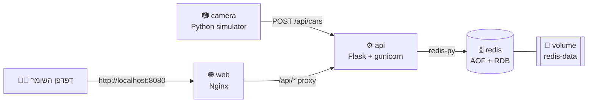

# 🅿️ Smart Parking - License Plate Tracker

**Track 2 - Full Stack DevOps** | מטלת Docker Compose

מערכת לניהול כניסת רכבים לחניון חכם. מצלמת IoT מזהה לוחית רישוי ושולחת אותה ב-`HTTP POST` לשרת ה-API, הנתונים נשמרים ב-Redis, ולוח הבקרה של השומר מתעדכן בזמן אמת (JavaScript `fetch` כל 2 שניות) בלי לרענן את העמוד.


---

## 👥 הצוות

| שם | תפקיד עיקרי |
|----|-------------|
| _שם 1_ | _לדוגמה: API + Redis_ |
| _שם 2_ | _לדוגמה: Dashboard + Nginx_ |
| _שם 3 (אם יש)_ | _לדוגמה: CI/CD + תיעוד_ |

---

## 🏗️ ארכיטקטורה



| שירות | Image | פורט חיצוני | תפקיד |
|-------|-------|-------------|-------|
| `web` | `nginx:1.27-alpine` + הקבצים שלנו | `8080` | מגיש את לוח הבקרה ומעביר (reverse proxy) את `/api/*` לשרת ה-API |
| `api` | `python:3.12-slim` + Flask | `5000` | ה-Backend: קבלת רכבים מהמצלמה, שליפה ללוח הבקרה, שחרור רכב וחישוב מחיר |
| `redis` | `redis:7.4-alpine` | — (פנימי בלבד) | מסד הנתונים, שומר לקובץ (AOF) בתוך Volume |
| `camera` | `python:3.12-slim` | — | מדמה את מצלמת ה-IoT: שולח לוחית אקראית כל 8-20 שניות |

החלטות התכנון והסיבות להן: [ARCHITECTURE.md](ARCHITECTURE.md)

---

## 🚀 הרצה

דרישות: Docker Desktop (כולל Docker Compose v2).

```bash
git clone <repo-url>
cd smart-parking
docker compose up -d --build
```

- לוח בקרה: **http://localhost:8080**
- API ישירות: **http://localhost:5000/api/cars**

```bash
docker compose ps          # מצב ה-containers וה-healthchecks
docker compose logs -f camera   # לראות את המצלמה שולחת לוחיות
docker compose down        # עצירה (הנתונים נשמרים!)
docker compose down -v     # עצירה + מחיקת ה-Volume (מאפס את החניון)
```

---

## 🔌 API

| Method | Path | תיאור | תשובה |
|--------|------|-------|-------|
| `POST` | `/api/cars` | המצלמה מדווחת על רכב שנכנס. Body: `{"plate": "123-45-678", "gate": "A"}` | `201` רכב נוסף · `400` לוחית לא תקינה · `409` כבר בפנים / החניון מלא |
| `GET` | `/api/cars` | רשימת הרכבים שבחניון כרגע, כולל זמן ומחיר עדכני | `200` |
| `DELETE` | `/api/cars/<plate>` | שחרור רכב, מחזיר את המחיר הסופי | `200` · `404` |
| `GET` | `/api/stats` | תפוסה, מקומות פנויים, הכנסות, 10 יציאות אחרונות | `200` |
| `GET` | `/api/health` | בדיקת חיים (כולל PING ל-Redis), משמש את ה-healthcheck | `200` / `503` |

דוגמה - "להיות המצלמה" מהטרמינל:

```bash
# bash / Git Bash
curl -X POST http://localhost:5000/api/cars -H "Content-Type: application/json" -d '{"plate":"123-45-678"}'
```

```powershell
# PowerShell
Invoke-RestMethod -Method Post -Uri http://localhost:5000/api/cars -ContentType "application/json" -Body '{"plate":"123-45-678"}'
```

הלוחית יכולה להגיע בכל פורמט (`1234567`, `12 345 67`, `12-345-67`): השרת מנרמל אותה לפורמט הישראלי (7 או 8 ספרות).

---

## ✨ מה הוספנו משלנו

| פיצ'ר | איפה בקוד |
|-------|-----------|
| 💰 **חישוב מחיר חנייה** - 15 ₪ ליחידה הראשונה ו-10 ₪ לכל יחידה נוספת שהתחילה. במצב דמו יחידה = 60 שניות (במקום שעה) כדי שיראו את המחיר עולה בלייב | `api/logic.py` → `calc_price`, `BILLING_UNIT_SECONDS` ב-compose |
| 🚨 **התראת חניון מלא** - באנר אדום מהבהב, וה-API מחזיר `409` למצלמה | `api/app.py` → `car_entered`, `web/html/app.js` → `renderStats` |
| 🚪 **כפתור שחרור רכב** - מחשב מחיר סופי, מעביר להיסטוריה ומעדכן הכנסות | `DELETE /api/cars/<plate>` |
| 😂 **הודעה מצחיקה לכל רכב שנכנס** - מוצגת כהתראה קופצת | `ENTRY_MESSAGES` ב-`api/logic.py` |
| 🌙 **Dark Mode** - נשמר בדפדפן | `initTheme` ב-`app.js` |
| 🥚 **Easter Egg** - לוחית פלינדרום (נקראת אותו דבר משני הכיוונים, למשל `12-343-21`) חונה בחינם. ויש עוד הודעה חבויה ב-Console של הדפדפן | `is_palindrome_plate` |
| 📷 **סימולטור מצלמה** - container נפרד ששולח POST אמיתי, כך שהדמו "חי" גם בלי ללחוץ על כלום | `camera/camera.py` |

---

## 💾 שמירת נתונים (Persistence)

Redis רץ עם `--appendonly yes`: כל פעולת כתיבה נרשמת לקובץ `appendonly` בתיקייה `/data`.
התיקייה `/data` ממופה ל-**Named Volume** בשם `redis-data`, שחי מחוץ ל-container.
לכן `docker compose down` מוחק את ה-containers אבל **לא** את ה-Volume, וב-`up` הבא Redis טוען את הקובץ ומשחזר את כל הנתונים.

בדיקה:

```bash
docker compose up -d
# מכניסים כמה רכבים (או מחכים למצלמה)
docker compose down
docker volume ls            # smart-parking_redis-data עדיין קיים
docker compose up -d
# הרכבים, ההכנסות וההיסטוריה עדיין בלוח הבקרה ✅
```

---

## 🔄 CI/CD

הקובץ [.github/workflows/ci.yml](.github/workflows/ci.yml) רץ בכל `push` ובכל Pull Request:

1. **unit-tests** - `pytest` על הלוגיקה (נרמול לוחיות, חישוב מחיר, Easter Egg).
2. **docker-build** (רק אם הטסטים עברו):
   - `docker compose config` - בדיקת תקינות ה-YAML
   - `docker compose build` - בניית כל ה-Images
   - `docker compose up -d --wait` - הרמת המערכת והמתנה ל-healthchecks
   - Smoke test: `POST` של רכב דרך Nginx ובדיקה שהוא מופיע ב-`GET`
   - **בדיקת Persistence אוטומטית**: `down` → `up` → הרכב עדיין שם
   - בכישלון - הדפסת הלוגים של כל ה-containers

🎁 **בונוס (בהמשך)**: דחיפת ה-Images ל-GitHub Container Registry עם תיוג גרסאות.

---

## 📁 מבנה הפרויקט

```
.
├── docker-compose.yml        # 4 שירותים + volume
├── api/
│   ├── Dockerfile
│   ├── app.py                # Flask routes + Redis
│   ├── logic.py              # לוגיקה טהורה (נבדקת בטסטים)
│   ├── requirements.txt
│   └── tests/test_logic.py
├── web/
│   ├── Dockerfile
│   ├── nginx.conf            # static + reverse proxy ל-/api
│   └── html/                 # index.html, app.js, style.css
├── camera/
│   ├── Dockerfile
│   └── camera.py             # סימולטור מצלמת IoT
├── .github/workflows/ci.yml
├── README.md
├── ARCHITECTURE.md           # החלטות ארכיטקטוניות
└── AI_USAGE.md               # תיעוד השימוש ב-AI
```

---

## 🎤 תסריט ל-Demo Day (5-10 דקות)

1. `docker compose up -d --build` ו-`docker compose ps` - ארבעה שירותים, כולם `healthy`.
2. פותחים את http://localhost:8080 - המצלמה כבר מכניסה רכבים, הודעות מצחיקות קופצות.
3. "אנחנו המצלמה": שולחים `POST` מהטרמינל - הרכב מופיע בלוח בלי רענון.
4. מכניסים `12-343-21` מהטופס - Easter Egg, חנייה בחינם.
5. מראים את המחיר עולה כל דקה, ולוחצים "שחרור רכב" - המחיר נכנס להכנסות ולהיסטוריה.
6. ממלאים את החניון (או מחכים) - התראת חניון מלא, והמצלמה מקבלת `409` (`docker compose logs camera`).
7. מעבר ל-Dark Mode.
8. **Persistence**: `docker compose down` → `docker compose up -d` → הכל עדיין שם.
9. מראים ריצה ירוקה ב-GitHub Actions.
